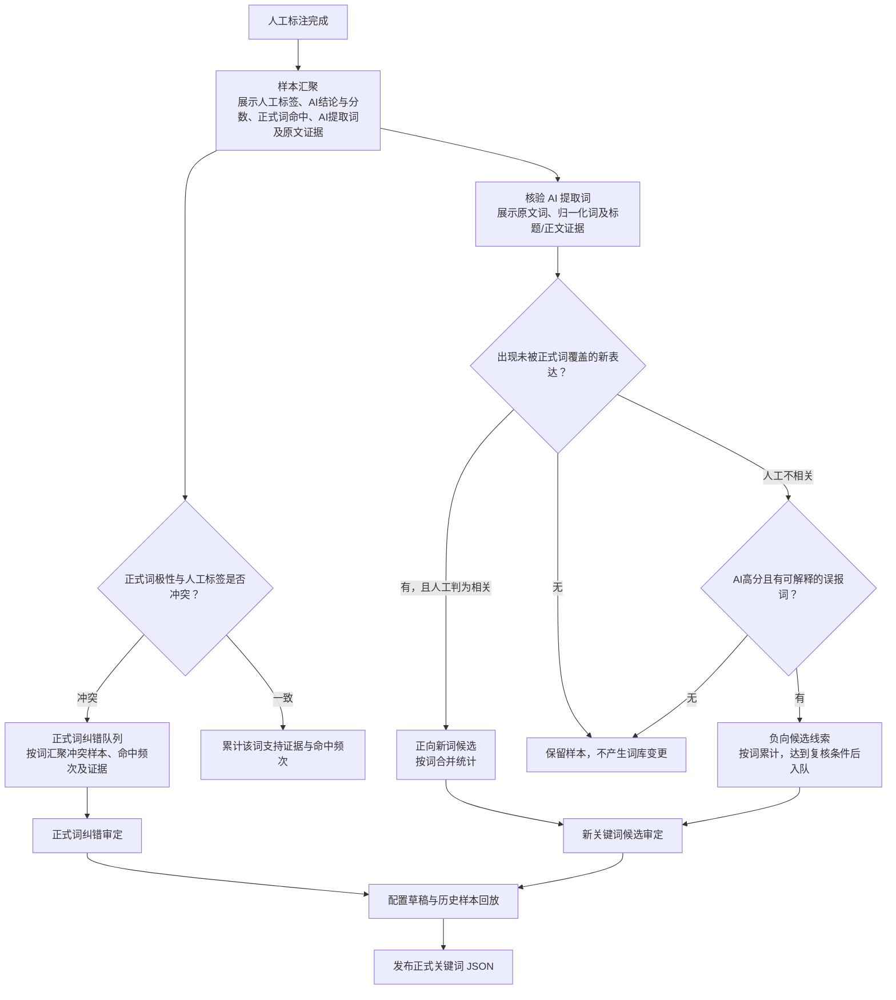

# 招标信息关键词治理 PRD v0.1

更新日期：2026-10-31
状态：按已确认的三条治理业务线实施  
范围：后台导航、业务关键词维护、正式词纠错、新关键词筛选及其候选词发布流程。

## 1. 背景与目标

人工复核与 AI 分析会不断产生两类治理信号：正式词库中的词可能已不适用；未被正式词库覆盖的表达则可能值得新增。若把它们放在同一个列表里，用户难以判断正在处理“维护已有词”“纠正错误命中”还是“筛选新词”，也容易把文章证据重复当成关键词。

关键词治理以**词条**为中心，文章只作为判读证据。系统需要把三类工作放到清晰、互相可达但职责独立的菜单，并保留必要的人工确认、历史样本回放和正式发布门槛。

## 2. 一级菜单与职责

一级分组：**关键词治理**。

| 菜单 | 工作对象 | 主要任务 | 结果 |
|---|---|---|---|
| **关键词治理总览** | 三条治理线的共同流程 | 以可见的流动线流程图解释样本汇聚、证据分流、两类词条队列、草稿、回放和发布；提供到具体工作页的入口 | 只读说明，不写入数据、不调用模型 |
| **业务关键词** | 当前企业业务能力及正式词库 | 维护业务能力、正向词、负向词和现行配置；查看正式词频次 | 保存业务配置草稿并按现有测试、发布流程生效 |
| **正式词纠错** | 已在正式词库中的词条 | 聚合该词命中的人工判读冲突；记录保留结论或提出修改、停用建议 | 修改/停用候选经独立纠错草稿、历史样本回放、人工确认后发布 |
| **新关键词筛选** | 尚未进入正式词库的 AI 提取词条 | 汇聚已标注文章、提取并去重 AI 词组、人工审定、统计词频、配置新词 | 新词候选经新词草稿、历史样本回放、人工确认后发布 |

三个菜单指向同一份正式业务词库，但工作列表和待办项不混在一起。**业务关键词**是现行规则的管理入口；另外两条流程分别负责纠正已有词和新增未收录词。

## 3. 业务线一：业务关键词

### 3.1 页面范围

- 保留现有企业业务能力配置、编辑、保存草稿、测试、发布、回退能力。
- 正向词仍归入对应业务能力和语义角色；负向词仍归入现有负向词配置。
- 正式词频次作为页面内的独立统计视图，展示按词条去重后的文章命中、人工相关、人工不相关和已精选次数。
- 频次统计可引导用户前往“正式词纠错”复核冲突，但不在统计页直接修改词条。
- 运行时配置仍沿用现有 兼容业务 JSON，不创建第二套正式词库。

### 3.2 不在本菜单处理

- 未入库的新词证据、候选聚类与采纳判读归“新关键词筛选”。
- 正式词被人工判为不相关后的修改、停用判断归“正式词纠错”。

## 4. 业务线二：正式词纠错

### 4.1 工作对象和汇总方式

以正式词条为主键聚合人工判读冲突，同一个词无论命中多少篇文章，都展示为一项词条纠错任务，并附上证据文章。至少显示：

- 正式词、词性、业务能力和语义角色。
- 已判读文章命中数、人工相关数、人工不相关数、当前未解决的冲突数。
- 可回溯的标题、人工标签、AI 判读和业务分，以及原文证据入口。
- 词频入口，便于结合总命中与冲突比例判断词条是否范围过宽。

### 4.2 可执行判定

| 人工结论 | 操作 | 后续状态 |
|---|---|---|
| 该正式词仍有业务价值 | 确认保留并填写判读理由 | 记录本次纠错结论；后续新冲突证据可再次出现 |
| 该正式词过宽或不准确 | 修改正式词 / 提出替换词 | 创建正式词调整候选 |
| 该正式词不应继续命中 | 提出停用 | 创建正式词调整候选 |

单篇冲突不触发自动停用。候选建议也不会直接修改当前运行词库。保留结论会按现有规则消除该词当前已知冲突；之后产生的新冲突可重新汇聚。

### 4.3 发布闭环

```text
正式词冲突按词汇总
    → 人工确认保留 / 提出修改 / 提出停用
    → 选择正式词调整候选并生成纠错草稿
    → 在已标注样本上回放命中变化
    → 人工核对变化指标和文章样例
    → 发布到现有正式业务 JSON
```

回放仅重新计算词表命中，不重新调用 AI、不改写历史人工标签。只有完成回放并确认后才可发布。发布原因写入审计记录。

## 5. 业务线三：新关键词筛选

保留现有五步工作流，处理尚未进入正式词库的 AI 提取词：

1. **样本汇聚**：回看已完成的人工判读；按文章展示 AI 判读、关键词命中和原文证据。已命中正式词只作证据，不当作新词。
2. **AI 归类与词条判读**：基于已有分析结果抽取标题或正文中的业务任务词、动作词、成果词和变体；按标准词去重聚类。词条必须能追溯到文章和原文证据。读取页面不触发模型调用。
3. **候选词池**：按标准词汇总来源文章数、相关/不相关人工标签和近期出现频次；重复证据增加该词的统计，不重复创建文章行或词条。
4. **新词草稿与回放**：只选新词簇，关联业务能力和角色，生成配置草稿；比较草稿词库与现行词库在已标注样本中的命中变化。
5. **正式词库**：人工核对回放后发布。确认后的正向词进入对应能力的 `semanticRoles`，负向词进入 `reviewNegativeTerms`，仍写入原有兼容业务 JSON。

本流程不再显示或选择“正式词调整候选”。已有词的保留、修改和停用全部在“正式词纠错”处理。

## 6. 两条变更流程的共享规则

- 新词新增与正式词纠错最终都更新现有业务配置和同一份运行 JSON，但生成不同类型的治理草稿，页面继续留在对应菜单下。
- 当前配置草稿是全局单份，因此同一时刻只允许推进一份未发布的业务词库草稿。新词草稿进行中时，正式词纠错暂不另起草稿；正式词纠错草稿进行中时，新关键词筛选也暂不另起草稿。
- 创建新草稿前检查现有业务配置草稿；未完成的人工配置草稿不得被治理流程覆盖。
- 已存在的历史合并草稿若同时包含正式词调整和新词，应明确列出两类内容并作为一份存量草稿完成回放/发布；新建草稿从本版本起按业务线隔离。
- 发布只影响之后的新采集和新分析，不回写历史文章分析结果或人工标签。
- 不支持按单个关键词配置运行时行业限制。行业范围可以作为治理记录信息，但不得伪装成当前 JSON 已具备的过滤能力。

### 6.1 人工复核队列与低分规则

- 总分由业务、地域和开标时效等分项共同组成。低总分本身不代表业务无关；批量低分规则还必须同时满足业务分为 0、没有正向或负向正式词命中、AI 未判相关等条件。
- 低分批量标记门槛为**总分严格低于 25 分**，总分恰好 25 分不纳入。其余既有条件不变：仅处理未人工标注、AI 为 BLOCK 或 UNKNOWN 且业务判读标签不是 PASS、业务分为 0、没有正向或负向正式词命中、非中标结果的文章；不要求正文或摘要已读取。
- 批量操作只新增人工“不相关”标签，保留 AI 原始结论和分数，不自动生成负向关键词候选。
- “低业务分 + 无关键词命中”是额外的人工抽查样本池，不代表全部都必须人工标注。每次查询按稳定的每日顺序最多抽取 5 篇，并同时展示抽查数与符合条件总数；未抽中的文章保持未标注。
- 该额外抽查池排除 AI 结论为 UNKNOWN 的文章，因为 UNKNOWN 已进入重点人工复核队列；因此 UNKNOWN 不会因每日抽样上限而被漏掉。抽查范围仍受页面当前的时间范围、批次、搜索和人工标记状态约束。
- 常规重点复核继续包含 UNKNOWN，以及符合原有条件的 PASS 样本；低业务分无关键词抽样不会替代或改变这些规则。

## 7. 导航与跳转

```text
关键词治理
├─ 关键词治理总览（只读流程说明）
├─ 业务关键词
│  └─ 正式词命中频次 → 正式词纠错
├─ 正式词纠错
│  ├─ 冲突文章 → 原文/样本证据
│  └─ 调整候选 → 纠错草稿 → 回放 → 发布
└─ 新关键词筛选
   └─ 样本汇聚 → AI 归类与词条判读 → 候选词池 → 新词草稿与回放 → 正式词库
```

页面内跨菜单链接只用于查看相关信息或继续对应待办，不改变任务的归属菜单。比如纠错文章可回看原样本，正式词频统计可打开纠错列表；纠错候选不会被带入新词候选池。

### 7.1 流程总览页

- 在“关键词治理”分组下新增独立菜单“关键词治理总览”，作为治理流程说明入口；现有三个操作菜单保持原职责和顺序。
- 页面按下列节点和分支方向呈现完整流程，使用系统现有样式和流动线动画；支持手动暂停，系统开启减少动态效果时保持静态流程线。



- 图中只保留流程节点、分支条件及必要证据字段；“冲突”和“新词候选”进入各自审定队列，“一致”和“无词库变更”路径终止于样本 / 频次记录。
- 页面只呈现流程说明和静态规则，不重新调用模型、不执行词条判读、不更改词库或治理草稿。

## 8. 验收标准

1. 后台“关键词治理”分组展示只读“关键词治理总览”及“业务关键词”“正式词纠错”“新关键词筛选”三个操作入口；业务关键词不再出现在“信源与业务”分组。
2. 四个菜单均可直接打开和刷新，标题、面包文案及跨页链接指向各自职责。
3. 业务关键词页仍能维护现有配置，并能访问正式词频次；频次统计能进入正式词纠错。
4. 正式词纠错按词条聚合证据；确认保留、提出修改、提出停用可用；单篇冲突不自动修改运行词库。
5. 纠错候选可单独生成草稿、进行历史回放并人工确认发布；当前词库只在发布成功后更新。
6. 新关键词筛选五步流程保持可用，候选词池和新词草稿不再列入正式词纠错候选。
7. 已有未完成的其他配置草稿时，系统显示明确提示并阻止新治理草稿覆盖它；未完成的另一种治理草稿也不能被新流程覆盖。
8. 新词与纠错发布都沿用现有业务配置版本、审计、回放及 JSON 输出机制，不生成第二份独立词库。
9. 页面读取不触发模型调用；回放仅做历史样本的词表命中计算。
10. 流程总览完整复刻 7.1 中的节点、分支标签、终止路径、两类审定队列、配置草稿与历史回放、正式 JSON 发布；不得隐藏或增加流程判定节点。
11. 桌面端正式词与 AI 提取词分列左右两支，分支条件和流向清晰；窄屏无横向裁切，节点文字保持清晰可读。
12. 流动线可手动暂停；系统启用减少动态效果时不播放动画。
13. 流程总览只解释流程，不调用模型、不执行词条判读、不更改词库或治理草稿。
14. 低分批量判读严格使用总分低于 25 分，并保留原有业务分为 0、无正负关键词命中、AI 非 PASS、未人工标注及非中标结果等条件；总分 25 分不符合。
15. 低业务分无关键词队列每次最多展示 5 篇稳定每日抽样样本，另行展示符合条件总数；UNKNOWN 继续进入重点复核队列，不与此抽样重复。

## 9. 本版不包含

- 自动根据单次或少量样本停用正式词。
- 用文章记录代替词条聚合；或把正式词纠错候选混入新词池。
- 新建现有 JSON 之外的第二份正式词库、第二套发布机制或关键词级行业运行时过滤。
- 自动训练/微调模型，或在打开后台页面时重新调用 AI 提取关键词。
